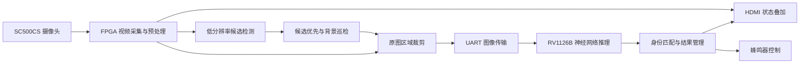

# BirdGuard · 智能鸟类监测系统

基于 FPGA 与边缘 AI 协同的鸟类监测系统。FPGA 完成视频采集、候选目标提取、原图区域裁剪和 HDMI 显示，RV1126B 执行神经网络推理，将识别结果回传至 FPGA，形成采集、识别、显示与驱离控制的本地处理闭环。

## 系统设计

- **双尺度处理**：在小尺寸网格上定位候选，再从原始图像提取识别区域，兼顾前端资源与目标细节。
- **动静结合送检**：运动、背景差分、颜色与融合模式提供候选，背景巡检为静止目标提供识别入口。
- **有界请求流水**：图像接收与模型推理通过队列衔接，每笔请求保存独立身份与区域信息。
- **识别与动作联动**：按有效识别结果更新目标状态，驱离动作采用保持与冷却控制。

| 项目 | 配置 |
| --- | --- |
| FPGA 平台 | 安路 HX1P35A，PH1P35MDG324 |
| SoC 平台 | RV1126B，EASY-EAI-NANO |
| 视频输入 | 1280 × 720 |
| 候选检测网格 | 160 × 120，最多 4 个候选 |
| 单幅识别图像预算 | 不超过 16 KiB，单边不超过 256 像素 |
| 业务串口 | 1,500,000 baud，8N1，3.3 V TTL |
| 请求配置 | 单请求 / 四请求流水 |
| 视频输出 | HDMI 原图、灰度与边缘视图 |

## 工程入口

| 目录 | 内容 |
| --- | --- |
| [fpga](fpga/) | RTL、IP、引脚与时序约束、工程配置和位流 |
| [soc](soc/) | 串口桥、推理程序、板端构建与部署入口 |
| [tests](tests/) | FPGA 仿真与 SoC 协议测试 |
| [tools](tools/) | FPGA 构建和工程检查工具 |
| [docs](docs/) | 系统架构、硬件连接、运行与协议说明 |

从[硬件连接](docs/hardware.md)和[运行说明](docs/operation.md)开始。设计分工与数据流见[系统架构](docs/architecture.md)，通信字段见[串口协议](docs/protocol.md)。

仿真、协议测试与构建签核入口见[工程验证](docs/validation.md)。

## 使用许可

项目原创内容按[教育与研究使用许可](LICENSE)提供。第三方组件保留原始版权与许可，来源见[第三方组件说明](THIRD_PARTY_NOTICES.md)。
